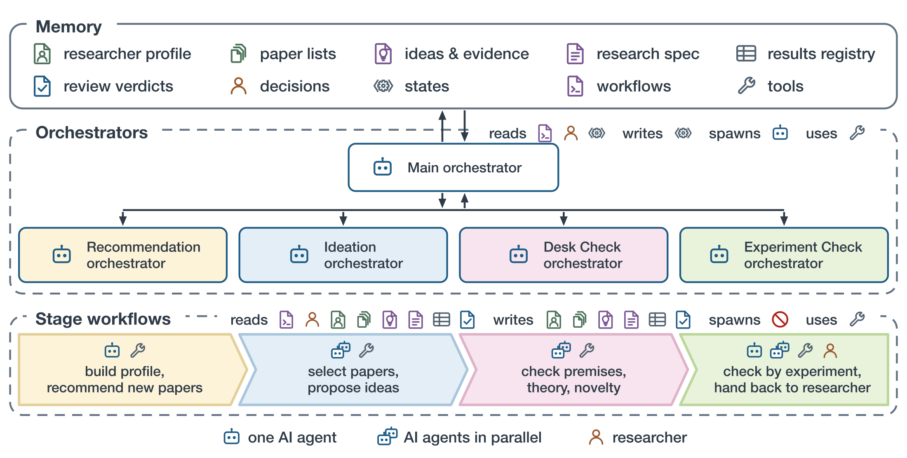
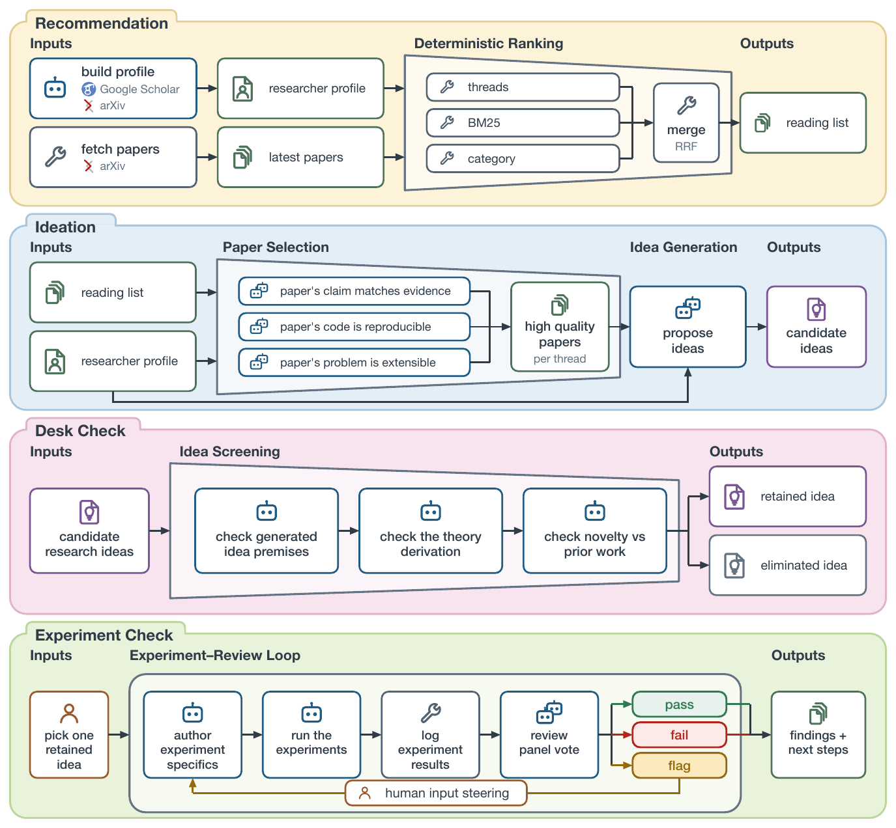
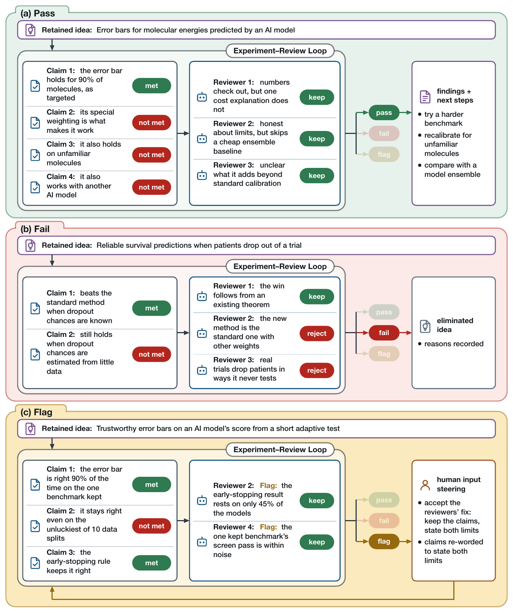
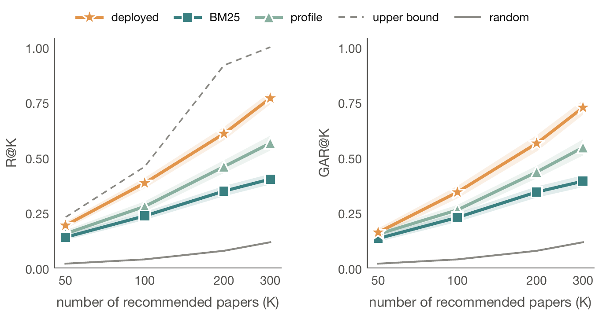
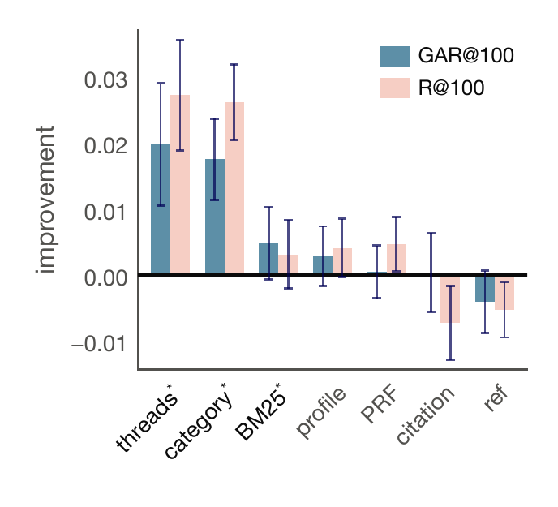
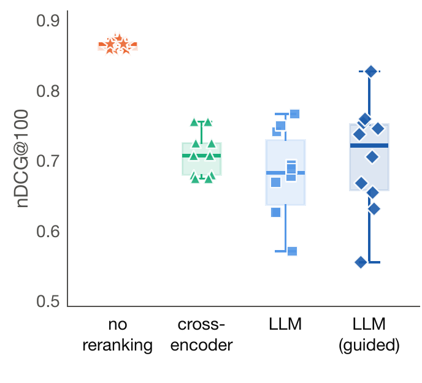
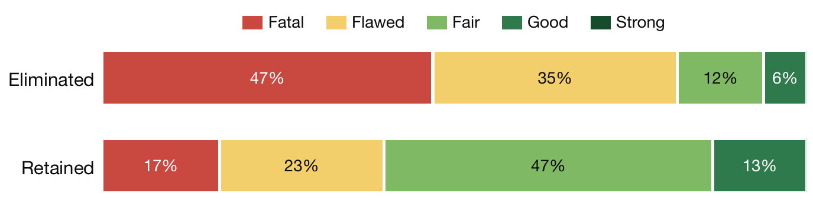
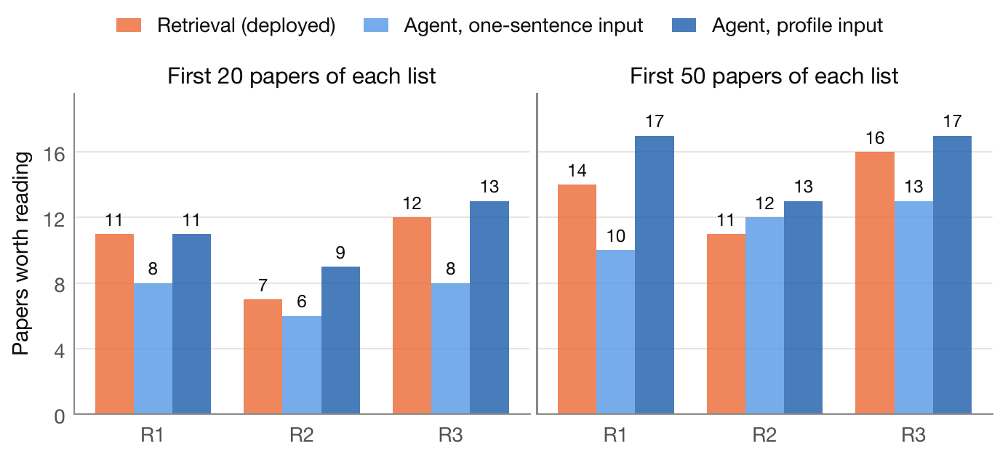

<div align="center">

# ideation-claude

**从「我该做什么研究?」到一份经过核验、对抗式评审的研究规格 —— 在一个 Claude Code 会话里完成。**

个性化 arXiv 推荐 · 核验式淘汰的想法生成 · 执行—评审循环 · 你只掌舵方向

[](LICENSE)
[](https://docs.claude.com/en/docs/claude-code)
[](RUNBOOK.md)
[](#参与贡献)

[快速开始](#快速开始) · [工作原理](#工作原理) · [实验结果](#实验结果) · [命令](#命令) · [目录结构](#目录结构) · [局限](#局限)

[English](README.md) | **简体中文**

</div>

<p align="center">
  
</p>

`ideation-claude` 是一组 [Claude Code](https://docs.claude.com/en/docs/claude-code) 插件(插件 id 为 `auto-research`,命令为 `/auto-research`):它把研究者自己的发表记录变成每周个性化的阅读清单,
由此提出研究想法,**用真正执行过的检查淘汰站不住的想法**,然后把存活下来的想法反复「执行实验 → 评审结果 → 改写研究规格」,
让规格越来越有抱负、越来越严谨。

整个过程只需要你做一件事:**选定要做哪个想法**(以及系统在某一轮提出方向问题时的方向决定)。其余全部无人值守,可随时中断恢复。

最终交付的是一份**研究规格**:`SPEC-FINAL.md`、它的演化记录 `SPEC-EVOLUTION.md`、`EXPERIMENTS/` 下的证据、以及 `FINAL-REPORT.md` —— 不是论文初稿。

## 特点

- **想法死在被执行过的证据上。** 候选想法依次经过 筛选 → 核验(跑*真正执行*的探针)→ 复核 → 反驳搜寻;被杀掉的想法不会被后续改写「复活」。
- **审计者不等于生产者。** 工作分三层 agent;评审者在互相独立的上下文里冷读;`spawn_guard` 钩子禁止无界嵌套。
- **数字不能被悄悄编造。** 报告的数值被冻结并追溯到审计账本;`ship_gate`、`lock_guard`、`decision_guard`、`central_narrow_guard`
  等 PreToolUse 钩子用机制而不是提示词来强制执行。
- **确定性的退出闸门。** 循环由评审结论的算术结果(`bin/loop_gate.sh`)决定是否结束,而不是模型自己宣布做完;
  与想法新颖性主张相悖的负结果是*放弃*信号,不是交付物。
- **人只掌舵方向。** 一个选想法的闸门 + 每轮的方向卡;其余常规闸门默认由冷读 agent 回答,你也可以改成自己回答。
- **可恢复、长任务安全。** 状态全部落盘;长实验分离运行,完成后零 token 成本唤醒会话。
- **配置集中。** 所有旋钮都在 `config/config.yaml`(另见 `key-config.yaml`);代码里没有隐藏默认值,缺键会带着键名直接报错。

## 工作原理

四个阶段按顺序运行,各自有自己的编排器,只有最后一步会再次回到你手上:

| 阶段 | 做什么 | 代码位置 |
|---|---|---|
| **Recommendation 推荐** | 建立研究者画像(Google Scholar / arXiv),抓取当周新论文,用确定性方式排序 —— 线索查询、BM25、arXiv 类别,经倒数排名融合(RRF)合并。 | [`plugins/arxiv-recommender-ar`](plugins/arxiv-recommender-ar) |
| **Ideation 想法生成** | 按研究线索挑选高质量论文(结论与证据相符 · 代码可复现 · 问题可延展),再提出候选想法。 | `plugins/arxiv-recommender-ar` |
| **Desk Check 案头检查** | 检查前提、理论推导,以及相对已有工作的新颖性。每个想法最终是「保留」或「淘汰」,理由被记录。 | `plugins/arxiv-recommender-ar` |
| **Experiment Check 实验检查** | 你选一个保留下来的想法。它变成工作单,进入「写实验细节 → 运行 → 记录 → 评审团投票 → pass / fail / flag」的循环;`flag` 会经人工引导回到循环。 | 根插件 + [`paper-polish-ar`](plugins/paper-polish-ar) + [`experiment-lab-ar`](plugins/experiment-lab-ar) |

<p align="center">
  
</p>

### 裁决长什么样

评审团每一轮给出三种裁决之一。下面三个是真实运行记录,按现行规则重放:**pass** 交回发现与后续步骤,**fail** 淘汰该想法并记录原因,**flag** 暂停等待人工引导后重新进入循环。

<p align="center">
  
</p>

### 三层 agent

| 层 | Agent | 职责 |
|---|---|---|
| L0 | 主会话(`commands/auto-research.md`,规格在 `spec/research.js`) | 状态机、闸门、与你交互 |
| L1 | [`orchestrator`](agents/orchestrator.md)、[`producing-worker`](agents/producing-worker.md) | 扇出到独立上下文,或独自承担一项重活 |
| L2 | [`leaf-worker`](agents/leaf-worker.md) | 一个有界的子任务;结构上不能再派生 agent |

拓扑细节与禁止的拓扑见 [`docs/agents.md`](docs/agents.md)。

## 实验结果

下面的图来自我们自己在「某位研究者标注的 12 周 arXiv 论文池」上的评测。工作点是看过标注后选的,所以曲线是样本内的示意,不是留出集上的基准。

**推荐。** 在每个列表长度上,部署配置都高于两个单信号基线。

<p align="center">
  
</p>

**哪些信号有用?精排有帮助吗?** 增益来自线索与类别两路信号;BM25 略有正向贡献;其余四路信号没有贡献。
在本评测中,没有任何一次精排运行(cross-encoder 或 LLM)超过确定性排序。

<table>
  <tr>
    <td width="50%"></td>
    <td width="50%"></td>
  </tr>
</table>

**案头检查淘汰得对吗?** 由一个外部判官(与生成、核验想法的模型不同家族)在看不到裁决的情况下给每个想法评级。被淘汰的想法被评为 *Fatal* 或 *Flawed* 的比例远高于被保留的。

<p align="center">
  
</p>

**检索 vs. 通读整周。** 给定研究者画像、通读整周论文的 agent,在三位研究者、两个深度上都不低于部署的检索;只给一句话描述时,在多数格子里落后。

<p align="center">
  
</p>

## 快速开始

**环境:** [Claude Code](https://docs.claude.com/en/docs/claude-code)、Python 3.11+(在 3.13/3.14 上测过)、`git`,以及数 GB 磁盘空间给想法生成环境(一次性拉取 PyTorch + SPECTER2)。
TeX Live(`pdflatex`、`bibtex`)可选,只有评审阶段渲染 PDF 时用到。

```bash
git clone https://github.com/RoyYu0509/ideation-claude.git ~/ideation-claude
cd ~/ideation-claude

# 一次性:想法生成用的 Python 环境(幂等)
bash plugins/arxiv-recommender-ar/bin/setup_venv.sh

# arXiv/OAI 礼仪:在 User-Agent 里留一个联系邮箱
export AR_CONTACT_EMAIL="you@example.com"

# 创建你自己的数据目录(画像、缓存、运行记录、状态),并固定为你本人 —— 代码目录保持只读
bash bin/ar-init.sh ~/my-research \
     --scholar "https://scholar.google.com/citations?user=<你的ID>" --aliases "你的姓名"

# 在数据目录里打开 Claude Code,并从本仓库加载全部四个插件
cd ~/my-research
R=~/ideation-claude
claude --plugin-dir $R --plugin-dir $R/plugins/arxiv-recommender-ar \
       --plugin-dir $R/plugins/paper-polish-ar --plugin-dir $R/plugins/experiment-lab-ar
```

在会话里:

```
/auto-research
```

不需要参数;它读 `state/pipeline-state.json` 决定是新开一轮、恢复某个闸门,还是恢复一个分离运行的任务。
在全新目录里,它会先确认你的身份,一次性建好研究画像,然后跑想法生成并停在**选想法闸门**。
可以在命令后跟一段自由文本来引导,例如 `/auto-research 一个关于 PDE 代理模型的保形预测方向`。

想走插件市场安装:`/plugin marketplace add RoyYu0509/ideation-claude`,再 `/plugin install auto-research@auto-research` 并安装另外三个阶段插件,之后在任何目录都可用。
想法生成的 Python 环境仍需在已安装的插件目录里初始化。[`RUNBOOK.md`](RUNBOOK.md) 写了环境准备、首次运行、恢复与权限。

长任务前先自检:

```bash
bash tests/run_all.sh      # 循环闸门、钩子、闸门、分离/唤醒等的 shell 测试
```

## 命令

| 命令 | 插件 | 作用 |
|---|---|---|
| `/auto-research [自由文本]` | `auto-research` | 完整流水线:想法生成 → 选一个想法 → 执行/评审/改写循环 → `SPEC-FINAL.md`。 |
| `/arxiv-scout-beta` | `arxiv-recommender-ar` | 只跑每周推荐 + 核验式淘汰的想法生成(前三个阶段)。 |
| `/review` | `paper-polish-ar` | 对稿件做顶刊口径的对抗式评审:独立冷读 → 一份按优先级排序的问题清单。 |
| `/polish`、`/polish-figures` | `paper-polish-ar` | 在数据、结论、引用冻结的前提下改写行文或重绘图。 |
| `/learn` | `auto-research` | 运行后对*系统本身*复盘:把每个产物映射回产出它的组件。 |
| `/auto-research-smoke` | `auto-research` | 接线探针:不做真实工作,只确认每个派生点都可达。 |

## 配置

| 文件 | 管什么 |
|---|---|
| [`config/config.yaml`](config/config.yaml) | 粘合层:循环轮数、退出闸门、角色→模型路由、里程碑。 |
| [`key-config.yaml`](key-config.yaml) | 按阶段排序的单一控制面板;用 `bin/apply_key_config.sh` 写回。 |
| [`plugins/arxiv-recommender-ar/config/config.yaml`](plugins/arxiv-recommender-ar/config/config.yaml) | 抓取、预筛、判官、淘汰循环。 |
| [`plugins/paper-polish-ar/config/config.yaml`](plugins/paper-polish-ar/config/config.yaml) | 评审团规模、轮数、角色→模型。 |

模型路由按角色配置(逐项扇出用便宜的模型,判断类调用用更强的);改上面的配置,不要改代码。

## 目录结构

```
.claude-plugin/        插件市场 + 根插件清单
commands/              /auto-research、/learn、/auto-research-smoke
spec/                  L0 状态机(research.js)、状态模型、闸门分类、派生提示词
agents/  hooks/        三层 agent;PreToolUse / Stop 守卫
skills/                handoff-authoring、research-amplify、research-rescue、experiment-engineering
bin/  config/  assets/ 确定性辅助脚本、配置单一真值、各期刊论文骨架
plugins/
  arxiv-recommender-ar/  推荐 + 核验式淘汰想法生成(Python + workflows)
  paper-polish-ar/       对抗式评审、/polish、/polish-figures、冻结钩子
  experiment-lab-ar/     实验 + 起草循环的工作规格
tests/                 shell 测试
docs/                  agent 拓扑、图
```

## 局限

- **只支持 Claude Code。** 编排依赖 Claude Code 的子 agent、钩子与 `AskUserQuestion`。
- **又贵又慢。** 一次完整运行会扇出很多子 agent,可能跑数小时;首次运行前请有意识地设置模型路由和 `max_loop_rounds`。
- **交付物是规格。** 实验用来检验并打磨规格;系统不写论文。
- **评测规模小。** 上面的结果来自少数几位研究者的数据;它们为设计提供依据,不能证明一般性能。

## 参与贡献

欢迎 issue 和 PR。每个阶段是 `plugins/` 下自包含的插件,直接原地修改。提 PR 前请跑 `bash tests/run_all.sh`,并把提示词放在
markdown/skill 文件里,不要内联进编排用的 JS(`spec/research.js` 刻意保持为薄规格)。

## 致谢

`plugins/paper-polish-ar/skills/nature-reader` 与 `nature-academic-search` 取自
[Yuan1z0825/nature-skills](https://github.com/Yuan1z0825/nature-skills)(MIT),见
[`plugins/paper-polish-ar/NOTICE.md`](plugins/paper-polish-ar/NOTICE.md)。`assets/` 下的 LaTeX 骨架保留其出版方原有许可。

## 许可证

[MIT](LICENSE) © 2026 Yifan Yu
